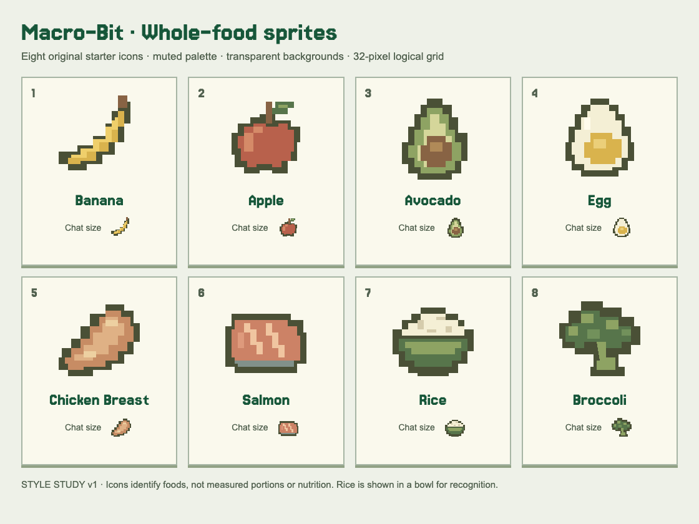

# Macro-Bit whole-food sprites, v1

Asset-only style branch requested by Matthew. These are the eight starter illustrations shown in the Studio contact sheet, preserved for review and future library expansion. No app code, asset-catalog membership, backend, food data, or behavior is changed.

## Preview

Open `preview.html` locally to see the enlarged illustrations beside their proposed 40px chat size. The HTML uses only relative assets and the bundled Jersey 15 font; no network access is required. This is a static style study, not an interactive app or a verified native render.

## Included foods

1. Banana
2. Apple
3. Avocado
4. Egg
5. Chicken breast
6. Salmon
7. Rice
8. Broccoli

## Visual contract

- Draw on a 32 x 32 logical pixel grid with integer-coordinate silhouettes.
- Use muted natural colors, dark olive outlines, restrained highlights, and transparent backgrounds.
- Keep a consistent visual weight, rather than forcing unlike foods into identical shapes.
- Use nearest-neighbor scaling and no image smoothing. Prefer integer scales when feasible; the contact sheet's 40px example is a readability study, not a production scaling prescription.
- Let the food name and portion remain readable native text. Never bake nutrition, quantities, or labels into the icon.
- Use sprites as decorative recognition aids, not as measured portions or evidence of nutrition, cooking state, ingredients, or allergens.
- The rice bowl is a recognition convention; it does not represent a serving size. The egg is shown cut open.
- Preserve the surrounding Macro-Bit sage/cream pixel Studio. This asset study follows the current app direction, not the older Design B rounded-card guidance in `FLEET_CREED.md`. It does not rewrite the repository's UI guidelines.

## Files

- `svg/`: eight editable SVGs with 32 x 32 view boxes and crisp-edge rendering.
- `png/`: eight 256 x 256 RGBA PNG exports.
- `food-sprites-contact-sheet.png`: numbered review sheet, enlarged and chat-size views.
- `preview.html`: local static sheet source.
- `manifest.json`: icon identifiers, paths, dimensions, and SHA-256 checksums for the copied assets.
- `Jersey15-Regular.ttf`, `Jersey15-OFL.txt`: existing project font and its OFL license, used only by the preview.

## Future integration boundaries

No food-to-icon matcher is implemented. Resolve food identity using canonical structured data when available, not loose substring matching. Portion variants should reuse the same icon. Unknown foods need a neutral fallback; compound meals must not be represented as a single ingredient merely because its name appears in the meal. Do not require an icon before a food can be logged. Icon absence must never block logging.

Expansion, icon approval, SwiftUI integration, semantic matching, and native accessibility verification are separate tasks. This branch is not a merge or release approval. No overnight generation is scheduled.

## Verification and provenance

Copied from Studio's `macro-bit/concepts/v4` style study. The SVGs are original AI-assisted, locally authored geometry rather than downloaded stock. No paid image generation was used. The PNGs and numbered contact sheet were rendered and visually inspected in Studio. Packaging checks validate the eight SVGs, PNG dimensions/RGBA encoding, preview-relative paths, and manifest hashes. No native application build or device test applies to this asset-only addition.

AI-assisted concept - run a trademark search before commercial use. The preview font is licensed separately under the included OFL. No exclusive-rights or trademark-clearance claim is made for the illustrations.
