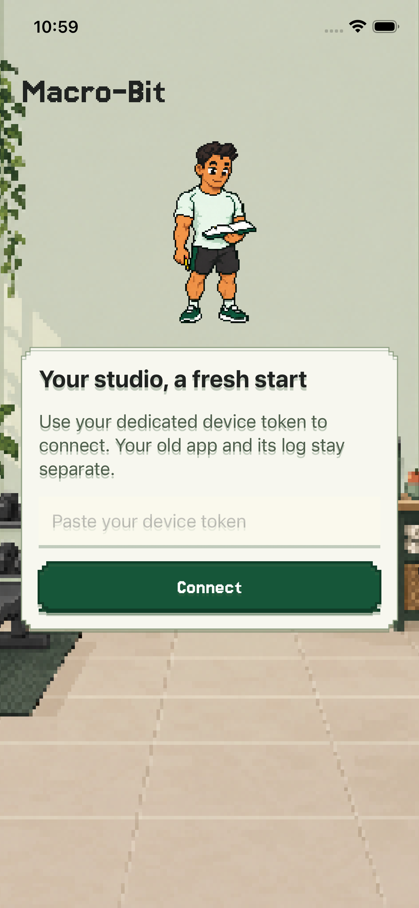
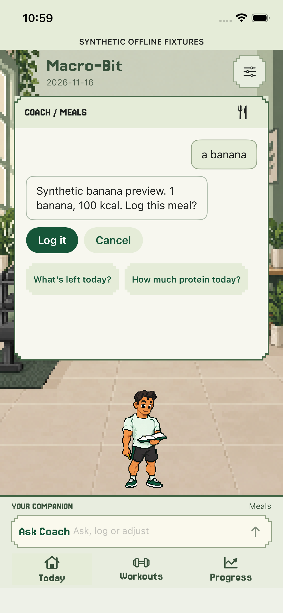
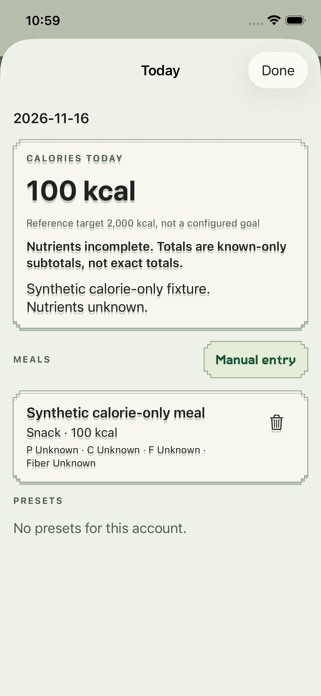
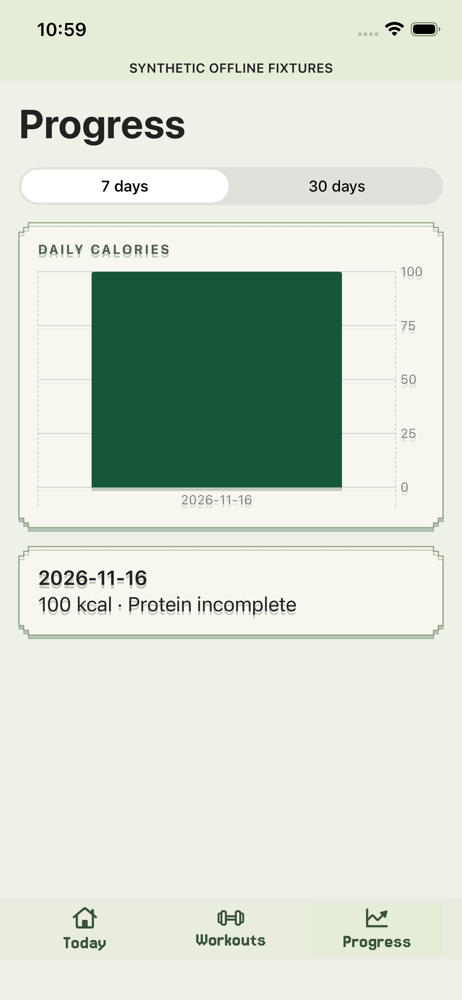
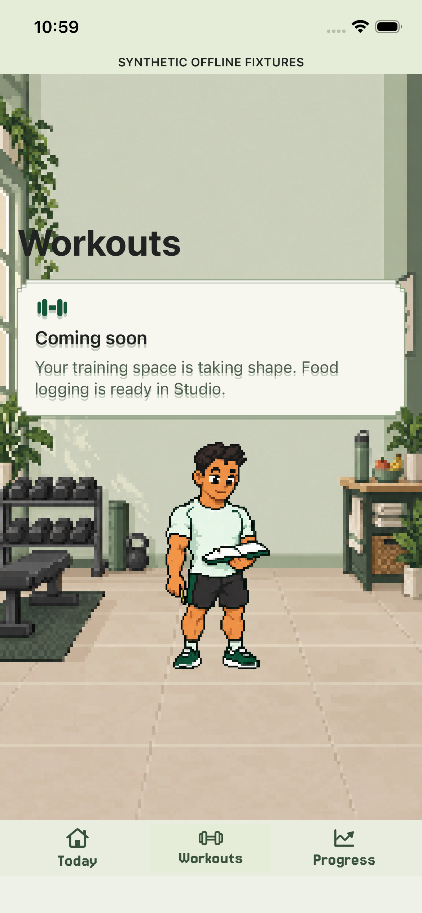
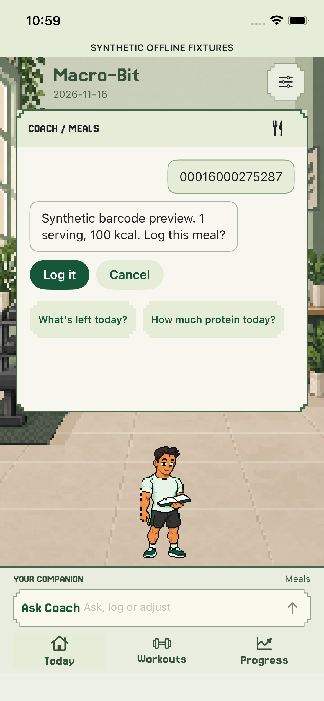

# Macro-Bit

A separate SwiftUI iPhone app. `ios/` and the legacy MacroTracker target are unchanged. No log migration is performed. Account data comes only from the device token's backend identity; an isolated TEST identity is required for acceptance.

## Source and configuration

Base and frontend source: `4db7c1245f979e9550dc165434a2206867cec0b2` (merged PR #13). Studio composition, `StudioLayout`, `StudioTabBar`, stepped `PixelPanelShape`, pixel buttons, Jersey 15 with its OFL, studio art and companion frames come from that revision. The old preliminary UI source is not used.

Food-only adaptations: app name, token screen, supported food actions, unavailable Workouts placeholder. There is one Studio conversation and one composer, not a separate Coach tab. The inherited home tab remains labeled Today.

Open `MacroBit.xcodeproj`, scheme `MacroBit`. App target `MacroBit`, unit target `MacroBitTests`, UI target `MacroBitUITests`. Bundle `com.biz21.macrobit`, display name Macro-Bit, automatic signing team `88A69374G2`, deployment target iOS 17.0.

`Base.xcconfig` includes `Config.xcconfig.template` plus an optional ignored `Config.xcconfig`. A clean checkout builds without local configuration. For local configuration, copy the template to `Config.xcconfig`. The committed URL is `https:/$()/mmmacros-backend.onrender.com`; the empty expansion preserves the URL in xcconfig. The app reads `MACRO_API_URL` from Info.plist and accepts only the hosted HTTPS origin. No credentials belong in configuration files.

## API behavior

Only today, dated day, presets, manual log, preset log, meal delete, trends and chat turn requests exist. There is no invite, history, action, product lookup, brief, plan or workout request. Models.swift and CoachChat.swift retain the existing Swift contract byte-for-byte.

Every request includes JSON Content-Type, nullable-v1 and bearer authentication. Normal requests use snake-case conversion and 45-second timeouts; chat uses literal turn_id/message and 120 seconds. Replies over 48,000 bytes or more than four quick replies are rejected before model decoding. HTTP 401 clears the token and scoped UI. Barcode 404 and 422 are coach messages; 409 is not automatically resent. 503 explains the cold start and leaves retry to the user.

The session UUID lasts for the app launch; new messages get new turn UUIDs. Retry after a transport failure reuses the exact original ID and message. A separate explicit user resend uses a new ID. No automatic confirmation or automatic retry. Every successful chat reply refreshes today because the fixed envelope has no saved flag. Manual/preset/delete also refetch today.

Scans close the scanner, enqueue an ASCII-digit message exactly once per scan event and drain after the current turn. Leading zeros survive. There is no product view. Today uses the server's effective_date. Nullable meal nutrients display Unknown; incomplete totals are not represented as complete. Manual entry requires all source values because unchanged LogMealBody is nonnullable: blanks are never zero. Unknown manual nutrients must go through chat, without changing the contract.

## Automated verification

Use a fresh dedicated simulator before entering any TEST token. Tests never require a backend identity.

    xcodebuild clean test -project ios-macrobit/MacroBit.xcodeproj -scheme MacroBit -destination 'platform=iOS Simulator,name=<installed iPhone>' -parallel-testing-enabled NO CODE_SIGNING_ALLOWED=NO

18 unit tests cover request headers/keys/timeouts, null nutrients/effective date, sign-out, quick replies, scan deduplication and queuing, barcode 404, status handling, retry identity, explicit new-turn resend, mutation refreshes, launch/session behavior, bundled font/license/art and animation.

2 mounted UI tests exercise the shared composer, quick replies and actual scanner-sheet callback with an injected result, plus capture six screenshots. Debug launch argument `-fixture-ui` installs a network-free URLProtocol and displays a permanent SYNTHETIC OFFLINE FIXTURES banner. It does not create or store a device token. This mode is absent in Release. Debug `-qa-injected-scan` only injects `00016000275287` when the user selects Scan Barcode; it does not sign in or issue a turn automatically. Ordinary launch uses the hosted API and the blank secure token screen.

Fresh MacBook Xcode 27.2 / iOS 26.5 run: clean succeeded, 18 unit and 2 UI tests passed, zero failures. Screenshots below are from those offline fixtures, not live API evidence.

## Remaining release gates

No live authenticated acceptance is claimed. The owner must enter an isolated TEST token directly in the simulator, never in a report, command, screenshot or log. Then verify these exact flows and record status/reply without credentials:

1. `a banana`, inspect preview, then tap `Log it`; verify one saved meal and refreshed today.
2. Inject scan `00016000275287`; inspect the normal chat preview and explicit buttons.
3. `how much protein today`.
4. Create a TEST manual entry, verify today, then delete only that entry and verify refresh.
5. Send an unknown barcode; verify its HTTP 404 text is a coach message and chat remains usable.

Fresh legacy regression: MacroTracker build succeeded. Its untouched test project ran 71 tests with 2 failures: existing ModelDecodingTests cannot find bundled `tomorrow-workout.json` and `calorie-only-day.json`. This is not a full legacy test pass and is not represented as Macro-Bit verification. A local template configuration was supplied only to an external regression copy, not to repository `ios/`.

Independent project review and owner's merge remain required. No backend changes, deployment, database/identity provisioning, real-user access, merge or physical-device install are part of this branch.
